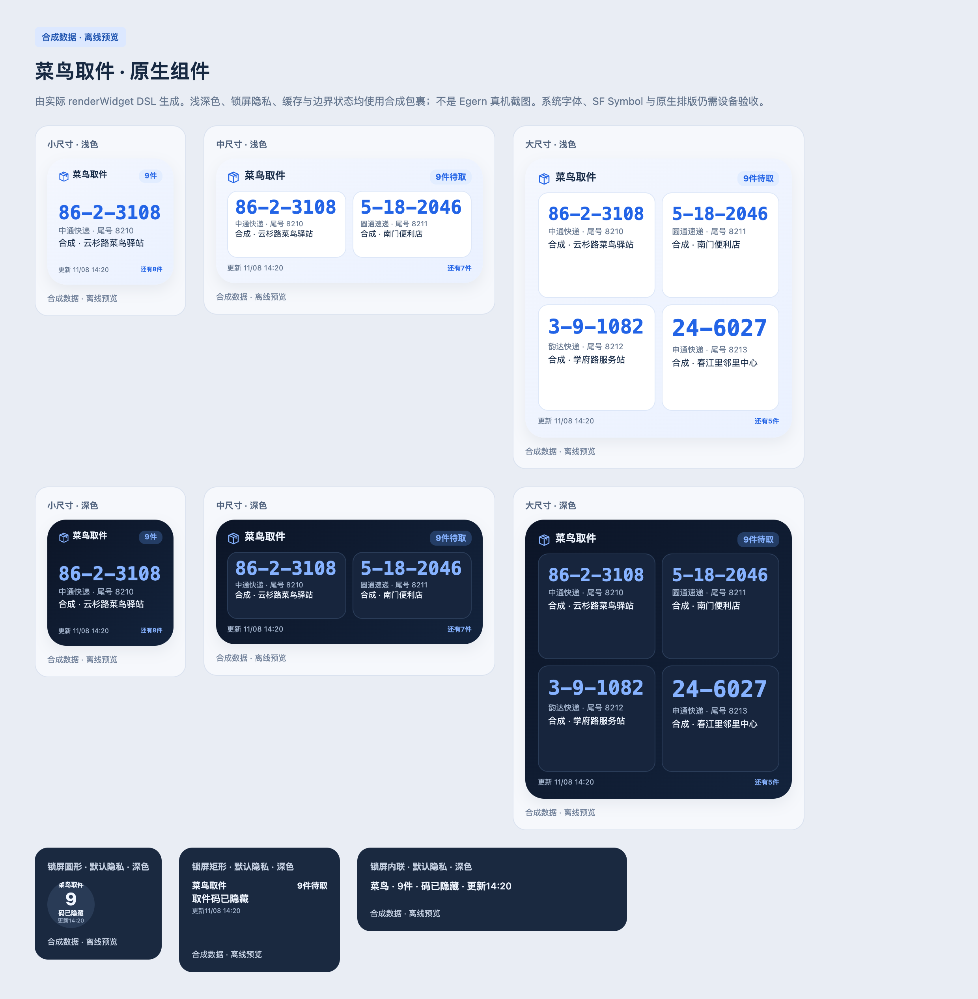

# 菜鸟取件 · Egern 原生小组件

在手机上显示待取数量和包裹信息。支持桌面四种尺寸、浅深色与锁屏三种尺寸；查询失败时保留上次结果和原更新时间。

**1.3.5 增加固定 RPC 拒绝类别。默认通过手机在线模块安装，不需要 ZIP、电脑、复制源码、HAR 或 Cookie。** 可以与[菜鸟去广告](../cainiao/README.md)一起使用，不依赖去广告模块或另装诊断。不读取短信、菜鸟私有存储或 App 沙盒，不修改 App 的请求和响应。

**1.3.5 正在发布。手机实际连接尚未验收。** 本版只为原合同的拒绝点保存固定类别，不保存原文、值、长度或未知键名，不放松请求合同。兼容旧形状，旧记录显示“未记录”，不凭历史类型反推类别；保留旧状态、终止与撤销保护。发布后继续依据新实际请求定位，不承诺更新就能接通。

1.3.4 实现 `08f2ab9`、树 `af520e0` 的 212 文件已核验，2026-11-09 18:27:32（北京时间）十四个公开原地址逐字节匹配。18:27 手机更新模块，18:29 generic 为 1.3.4；形状时间确为 `2026-11-09T10:09:18.248Z`，已确认属于 18:09 请求。除 brand 缺失外，其余已显示类型符合，但仍 unbound／SCHEMA_INVALID，独立尝试与成功均零；值边界或头校验的拒绝点尚未确定。独立摘要及关闭 App 后第二次新查询仍须分别验收。

候选仍须由本组件发起新请求并验证结果。返回范围是**官方待取摘要**，还不是完整包裹列表或结构化取件码，见[官方协议核对](官方小组件协议核对.md)。历史版本 1.3.0 的实现提交 `53c6764` 已推送至 `main`，2026-11-09 10:08:59（北京时间）十四个公开原地址回读同字节；这是旧版发布事实，不是本版发布或手机验收结果。此前补丁与失败记录保留。



[错误状态与长文本预览](preview/states-overview.png)。预览由实际组件 DSL 生成，不是 Egern 真机截图。

## 安装

已安装在线模块时更新原模块和它引用的远程 JS，不用重装自己的 CA、填写凭据或增加诊断模块。只有另建新版模块时才先停用旧模块，不要同时启用两份同名组件。远程脚本 URL 的 `?v=1.3.5` 只是缓存更新参数，不会锁定 Git 提交；升级需核对模块描述和 JS 首行。手机简短步骤见[1.3.5 接入说明](开始使用-1.3.5.md)。官方组件已经在主屏时保留即可，不再删除重装或退出重登；升级也不会复活旧失败代次。

首次接入：已有**菜鸟 App 自带的小组件**时，保持它在主屏，等待一次实际刷新。尚未添加时先添加一个，正常打开本人菜鸟 App 一次，再等官方组件刷新。回到 Egern 运行“菜鸟取件”；如果独立查询成功，再关闭菜鸟 App 运行一次，确认第二次新请求。iOS 正文和结果结构尚未确认，不保证更新后就能接通。

### 在线安装（默认）

**本地模块不是必要条件。** Egern 支持远程模块和远程脚本；一个模块加载全部七个入口和同一份自包含 JS，不需要另建文件或装依赖。新增的签发响应和查询参数采集属于小组件本体，不是另一个诊断模块；三个响应匹配互不重叠。

[在 Egern 一次添加菜鸟取件小组件](egern:/modules/new?name=%E8%8F%9C%E9%B8%9F%E5%8F%96%E4%BB%B6%20%C2%B7%20%E5%8E%9F%E7%94%9F%E5%B0%8F%E7%BB%84%E4%BB%B6&url=https%3A%2F%2Fraw.githubusercontent.com%2Fatopsecret%2FSurgeScripts%2Fmain%2Fcainiao-widget%2Fcainiao-widget.egern.yaml%3Fv%3D1.3.5)

如果当前阅读器不允许打开 `egern:`，把[远程模块地址](https://raw.githubusercontent.com/atopsecret/SurgeScripts/main/cainiao-widget/cainiao-widget.egern.yaml?v=1.3.5)添加到 Egern 即可；不用下载本地文件。模块描述和 JS 首行均应显示 **1.3.5**。本版仍在发布，只有原地址回读完成后才标为已发布。

1. 在手机点一次添加链接，确认添加 Egern 模块；客户端下载模块和脚本。保持 `CONNECTION_MODE=auto`、`CAINIAO_COOKIE` 留空，已有旧版先停用，不同时启用两份。
2. 保持 Egern 代理运行。**已有自己的 HTTPS 解密证书且已信任时，不用重装。** 尚未配置时按客户端指引安装并信任自己的 Egern CA。模块只声明四个原网关和新增的 `guoguouser.cainiao.com`，不代改手机系统设置。
3. 保留主屏已有的 **菜鸟 App 自带的小组件**，等它实际刷新一次；尚未添加时先添加一个，正常打开本人菜鸟 App 一次，再等官方组件刷新。模块只在手机本机读取该次请求中的实际 token 和已知业务参数，不要求重新签发、退出重登或导出凭据。**iOS 的实际正文尚未确认，因此此步不保证接通。**
4. 回到 Egern 的小组件画廊，运行“菜鸟取件”。实际 token 和合法模板已捕获时，它会自己发送带新时间戳的 POST；缺字段或结构不符合已知合同时明确停止，不猜设备值。
5. 关闭菜鸟 App，再运行本组件一次。如果这次新查询也成功，才确认本手机可以在 App 关闭时独立查摘要。添加 Egern 桌面组件并选择“菜鸟取件”即可；实际刷新由 iOS 调度，token 被服务端拒绝后仍需 App 重新接入。

官方安装入口与字段见 [Egern 小组件文档](https://egernapp.com/zh-CN/docs/configuration/widgets/)。客户端需支持模块 `widgets`、`generic` 脚本及原生 DSL；旧版本若没有小组件画廊，先更新 Egern。

Egern 官方一次添加模块格式为 `egern:/modules/new?name=NAME&url=URL`，是单斜杠 `egern:/`，且模块必须是手机可访问的 URL。上面的名称和模块 URL 各编码一次；新版原地址回读完成后才标为已发布，不使用未文档化的内联 JS、脚本 data URL 或附件自动导入。见 [URL scheme 文档](https://egernapp.com/zh-CN/docs/url-scheme/)。

### 分享给别人

**分享同一个公开安装链接即可，不需要分享 ZIP、源码、本地配置或你的登录态。** 对方在自己的 Egern 添加模块，按上方首次接入步骤初始化本人菜鸟官方组件，再验证本组件的新查询。凭据只存各自手机，不上传到模块仓库。模块和脚本更新由 Egern 的远程资源更新配置处理，不要求用户手工维护 JS。

在线安装解决的是分发和配置；App 会话兼容、关闭 App 后的新查询仍需要手机验收，不能把“安装成功”当成“已连接账号”。

### 开发归档（可选，不是手机安装要求）

此前本地 ZIP 保留为开发归档，其中的 `开始使用.md` 是本地试用说明，普通用户无需执行。仅需离线开发时，使用客户端支持的本地路径加载同一 JS 和 YAML；文件创建方式以实际版本为准。官方支持[本地脚本路径](https://egernapp.com/zh-CN/docs/configuration/scriptings/)和[本地模块路径](https://egernapp.com/zh-CN/docs/configuration/modules/)，没有保证 ZIP 自动安装 JS。本地文件不再作为默认手机交付。

## 手机连接没有成功时

“菜鸟连接状态”顶端先显示**官方取数**：是否捕获专用 token、实际模板是否匹配、新请求及成功次数、固定失败类别。形状包含记录时间和十项类型；1.3.5 增加固定拒绝类别 WRAPPER、APP_NAME、SOURCE、CHANNEL、BRAND、INSTALL_STATUS、VERSION、EXT、TOKEN、TIMESTAMP、LBS、RPC_HEADER、BODY，旧形状显示“未记录”。时间不是原请求的 timestamp 值；类别不包含原文、值、长度或未知键名。它不会显示 token、账号、模板值或包裹正文，也不会发送个人查询。只有主组件会请求本人包裹。

- **尚无专用 token**：还没有接受一条实际查询，或没有取得原签发路径的 token。连接列表里出现端点不等于正文已被接受；iOS 正文结构仍待确认。不要求反复开关 App、删除官方组件或重导 HAR。
- **已取得 token，但没有实际模板**：没有观察到相同 token 的官方查询，或参数不符合已确认合同。不伪填 `source=Android`、品牌、安装状态或授权版本。
- **专用 token 已拒绝**：停止同值重试，需 App 签发新的 token；Egern 不具有菜鸟原生续期能力。
- **官方摘要成功**：这是真正的新独立请求，但只确认摘要，不确认完整 PDS 或结构化取件码。取件数量大于零且摘要缺失时仍显示待取数量，不说“没有包裹”。

下面是兼容保留的旧 H5 状态，不代表新的官方取数是否成功：

- **尚未观察到 App 请求**：确认代理、四个主机的 HTTPS 解密和是否实际刷新快递列表。没有命中不能说明 App 未登录，也不能仅凭它归因证书、HTTPDNS 或 QUIC。
- **已看到请求，尚无完整会话**：组件看到了流量，但同一次请求没有完整账号与会话。不会拼接不同请求的 UID、SID 或 Cookie，也不会把原生一次性签名当登录态。
- **已捕获但未连接**：候选只在本人手机验证。仅获得 `_m_h5_tk`、公共时间 `SUCCESS` 或 COUNT 成功，都不够确认；必须完成本轮个人列表查询。
- **App 接入未确认**：首次候选还没通过完整个人查询。H5 拒绝它不能证明 App 已退出登录；停止同代次试探，不显示虚假的零包裹。运行“菜鸟连接状态”查看固定失败阶段和原因，新的实际 Cookie 采集后才再验证。
- **小组件会话失效或需验证**：先前已经确认的小组件会话不再有效，或服务端要求验证。在 App 刷新快递列表／完成验证后再回到组件。有效会话的网关 token 轮换由脚本处理，不要求每次刷新都打开 App。
- **本机存储异常**：检查 Egern 后重开 App 列表。写入会回读确认；没有写成功不声称凭据持久验证成功。新账号屏障已保存但候选写入失败时，也不会恢复旧账号查询。

同一模块里的 **“菜鸟连接状态”** 不发送个人查询，显示保存字段名、固定查询阶段／失败分类、发送对照和响应结构。它首次只向 `https://postman-echo.com/headers` 发送固定合成 Cookie，分别使用 `omit/include`；保存测试标记是否收到、额外 Cookie 是否存在等布尔值，不保存回显正文或头值。未知／超时不是 Cookie 被剥离，也不会自动切换业务查询的发送模式。七天固定窗口内不重复请求；中断但已占用窗口时显示未确认，不假装检查没发生。

网关下的请求观察字段是多请求并集，不能证明同次组合；实际保存字段单独显示。响应只保存固定类别、字段名、类型与数量，不显示 Cookie、SID、UID、签名、账号摘要、完整 URL 或正文值。失败记录和观察最多七天，读取不续期，过期不恢复终止候选。未看到已知登录 API 不等于 App 未登录。需要反馈时给这里的文字或截图即可，不再导 HAR，不另装工具。

自动凭据只保存在本人 Egern。专用路线保存 token、实际业务模板和有限执行状态；只捕获到实际查询时，用 token 摘要隔离这份 bearer 凭据，不将它标为已核实 UID。原签发路径保留同次账号摘要。新 token 建新代次，不继承旧摘要、确认或成功次数；已替换 token 的有界撤销记录阻止旧流量恢复会话。不保存 Cookie、原生签名、WUA、位置或 App 包裹响应；业务模板只保存必要的已知参数，不包含设备唯一标识。旧 H5 兼容会话及规范化快照仍保留。存储不承诺单独加密，不分享含手动 Env 的导出或私人存储。

手机 App 会话是否命中、原生兼容性、个人接口可用性和跨入口存储共享都尚待验收。Egern 仅文档化持久存储，没有承诺跨 VPN／组件进程的作用域或事务；同一脚本 URL 是实现策略，不是手机共享已经验证。

## 独立查询怎么运行

默认的接入路线：

```text
官方组件发实际查询 → 校验同次 token 与业务模板 → 建立 bearer 候选
或：App 同次 UID 与签发响应绑定 → 捕获同 token 实际查询 → 建立 UID 候选
本组件运行 → 新 timestamp + 专用 token → 固定 HTTPS POST → 新待取摘要
关闭 App → 本组件再次运行 → 第二个新 timestamp + 新 POST → 新摘要
```

bearer 候选只表示取得一份实际凭据，不表示核实了账号身份。请求正文仍必须符合已知的唯一 JSON RPC 包装和业务参数合同；没有先前签发记录不再阻止接入，未知 iOS 字段也不会被宽泛复制。明确身份冲突、退出、存储失败或代次变化仍会停止查询。旧 token 重现不恢复终止会话。

独立请求不携带 Cookie、SID、H5 sign 或 native 签名；只有固定的 JSON RPC 包装和官方已经声明的头。网络失败保留同一会话上次摘要及原时间，`INVALID_TOKEN` 不自行猜续期。已确认 iOS 使用相同端点和 JSON RPC 请求头，正文、业务结果与本组件首次／关闭 App 后第二次新查询仍待手机验收。官方待取数量采用 `agentSignPackNum`，摘要只筛 `logisticsStatus=900`；不混用 V2 计数、不从描述数字猜取件码，不声称查询了完整列表。

没有新的专用状态时仍保留以下旧 H5 路线；已有专用状态未就绪或被拒绝时，不退回旧账号 Cookie：

首次没有 `_m_h5_tk` 时按官方 MTOP 2.7.4 拼接 `undefined` 再签名，取得服务端实际 token 后正常重签。token 错误和 SESSION 失败分开处理；后者不能靠拿到 token 或跳过身份检查冒充登录成功。签名来源与会话限制见[协议核对](接入协议核对-1.2.1.md)。

```text
App 非公共请求中的真实 Cookie → 新签名的完整 PDS → 确认连接
App 同次真实 cookie2/sgcookie＋有效 native UID → 只补 unb → 身份匹配 → COUNT → 完整 PDS
App 同次 native SID/UID → 身份匹配 → COUNT → 完整 PDS → 确认兼容
App 同次合法 Set-Cookie＋同次有效 UID → 响应候选 → 身份匹配 → COUNT → 完整 PDS
之后关闭 App → 组件自己生成新 t/sign → 新 PDS → 更新显示
```

完整真实 Cookie 优先；缺 `unb` 但同次有实际 `cookie2/sgcookie` 和有效 `x-uid` 时保留七项白名单原值，只补 `unb`，不要求 SID，不用它覆盖 `cookie2`。只有没有实际会话 Cookie 时才试原 SID 候选。两类真实 Cookie 状态即使已终止，也不会被 SID-only 流量降级；弱流量不能撤销另一账号保存失败留下的屏障。新的真实 Cookie 请求可以重新接入。

`x-sid` 作为候选 `cookie2`、`x-uid` 作为候选 `unb` 的对应尚无协议等价证明。SDK 的 SID 注册与 Cookie 注入是独立路径。本版只能有限试验，并以独立身份结果和业务查询拒绝不兼容候选。

身份检查固定使用 `mtop.user.getUserSimple`，原文 `data={}`。官方页面消费顶层 `userNumId`；仅这个值为正十进制字符串或正安全整数、与捕获 UID 相同才继续。缺失、零、不安全数、嵌套别名和昵称都不补判。接着检查 `mtop.cainiao.lpc.packageservice.user.package.count.query`，再查询完整 PDS；账号检查时间只在全部成功后保存。官方消费代码不等于当前 H5 schema 保证，因此这个严格检查可能拒绝尚未适配的真实响应。

三类受限候选的身份验证同时绑定本机稳定会话摘要。业务查询中的短期 H5 token 更新不要求重验；稳定会话 Cookie 轮换则丢弃当次响应，重新检查身份和 COUNT，并从 PDS 第一页取数，最多三轮、共用十八秒预算。缓存、凭据代次及当前会话的验证记录都一致时，下一轮才直接查 PDS；缓存缺失或写入未确认会重新验证。服务端删除最后一个登录会话 Cookie 时立即停止，不会用剩余 UID 继续查询或确认空列表。

服务端响应候选只能由同次实际 `Set-Cookie` 形成，`cookie2/sgcookie` 不能借旧缓存；UID 只取同次响应 `unb` 或同次请求的实际 UID。Domain 必须同时合法于响应来源和目标 `h5api.m.taobao.com`，Path 必须同时覆盖身份、COUNT、PDS；其它主机的 host-only Cookie、菜鸟来源伪称 `.taobao.com` 和单个 API Path 均拒绝。候选不等于可用登录。相同稳定响应会话失败后，重复响应或 token 变化不复活；新稳定响应会话才新建代次。

公共时间请求只记录字段，完整 Cookie 也不建立／替换候选、不恢复失败或撤销另一账号屏障。它同次明确 UID 冲突仍会隔离；正常非公共新账号采集及写失败后的有效再采集不受阻。首次未确认的完整 Cookie 被拒绝时只纠正显示，保存的 `expired`、诊断和停止状态不改；已确认后的会话失效保留旧结果与原时间。

三个已知 `com.taobao.mtop.mLoginUnitService.login/autoLogin/logout` 的正文只看固定结构路径及字段类型，不提取登录 token，不递归搜值。解析最多 256 KiB，已读字节始终透传；`arrayBuffer()` 没有流式硬截断能力，未知长度实际超限时不解析。压缩或二进制只记录分类，不猜测当前 iOS 协议，也不要求反复登录触发旧 SDK 接口。

## 排版

| 尺寸 | 显示内容 |
| --- | --- |
| 桌面小号 | 待取总数、第一件官方摘要、驿站及尾号；旧 H5 模式显示结构化取件码 |
| 桌面中号 | 两件取件卡片及总数 |
| 桌面大号 | 四件；超过可见范围会提示还有多少件 |
| iPad 超大号 | 最多八件 |
| 锁屏圆形、矩形、内联 | 默认隐藏整个官方摘要与旧 H5 取件码；可显式开启取件信息 |

官方摘要只显示数值状态 `900` 的描述，不从数字猜取件码，计数沿用官方字段；未提供摘要时不假说没有待取。旧 H5 模式有多件时按有码优先、相同驿站相邻排列；缺码与需短信验证会显示文字提示，不把 `NEEDSMS` 当取件码。完整运单号、结构化收件人姓名、地址、电话和商品图片不另行缓存。官方描述可能含取件信息，因此锁屏默认隐藏整段描述。

组件不再把查件网页作为点击或接入入口。没有核实可用的 App scheme，默认不设置 `url`，由 Egern 处理点击。不伪造详情页，不承诺点击复制或标记已领取。

## 参数

| 键名 | 默认 | 作用 |
| --- | --- | --- |
| `CONNECTION_MODE` | `auto` | 有官方专用状态时仅用新路径；尚无新状态时保留旧 H5；`manual` 只用手动参数；`off` 下次执行清除本机状态 |
| `CAINIAO_COOKIE` | 空 | 仅用于手动或尚无官方状态的旧 H5 备用；不作为专用 token，不必填写 |
| `REFRESH_MINUTES` | `15` | 建议刷新间隔，范围 `5–120` 分钟 |
| `LOCKSCREEN_SHOW_CODE` | `false` | 改为 `true` 才在锁屏展示官方摘要或旧 H5 取件码 |

允许锁屏展示取件信息后，旁人也可能看到。桌面官方模式展示摘要，旧 H5 模式才展示结构化码；需要隐藏时使用锁屏默认布局。刷新由 iOS 决定，`refreshAfter` 只是建议，不能保证每十五分钟执行，更不保证领取后立即消失。刷新限制见 [Apple WidgetKit 文档](https://developer.apple.com/documentation/widgetkit/keeping-a-widget-up-to-date)。

## 查询失败时

- 未连接：显示 App 接入阶段，不显示“没有待取”。
- 官方摘要查询失败：保留同一凭据会话上次摘要及原时间，明确标旧数据；新 token 不继承旧会话摘要。`INVALID_TOKEN` 停止，不尝试复制原生续签。
- 旧 H5 登录过期、需验证或暂时断网：保留上次完整结果，明确标注“上次结果”和原更新时间。
- 旧 H5 分页没取全：有旧快照时显示旧快照；没有旧快照时显示已经查到的部分，数量标为“至少”。部分结果不会覆盖完整缓存。官方摘要没有已确认的分页合同。
- 响应格式变化：显示接口变化提示，不把未知结构当空列表。
- 切换账号：新账号先建立隔离屏障，再保存候选；新候选写失败也不继续查询已知旧账号。查询途中捕获更新会停止旧任务，不把另一账号的码作为结果返回。
- 并发刷新：每次运行单独记录归属，迟到的旧任务不覆盖较新的完整快照。
- 初始缓存写入失败：仍检查后续成功保存的账号屏障和其他任务结果；没有取得归属不代表可以覆盖新状态。
- 登录标志写入失败：缓存可写时会留下当前候选的终止记录，后续停止重复验证；新的 App 捕获才恢复。全部存储不可写时会提示失败，不能承诺下次不重试。
- 超过七天的旧数据：不再展示旧码。需要退出时，将 `CONNECTION_MODE` 改为 `off` 并运行一次组件；确认提示已清除，再清空可选的手动 `CAINIAO_COOKIE`。`off` 不会代你修改参数中的原文。

关闭或切换账号后，iOS 已显示的旧 timeline 可能仍保留到下次系统刷新；请主动在组件画廊重新运行，必要时移除桌面旧组件。脚本无法立即擦除系统已经绘制的历史画面。

旧 H5 业务请求限定到 `h5api.m.taobao.com` 的固定身份、COUNT 和个人列表路径；新官方摘要请求只使用上文固定的 `guoguouser.cainiao.com` POST。两条路径均不跟随重定向、不调用第三方签名服务。H5 每次生成新时间戳和签名；官方摘要只用专用 token 与新时间戳，不复制原生签名。每轮共用约十八秒预算。新官方状态存在时，旧 H5 捕获只观察，不改账号屏障，也不退回旧查询。失败快照保留原更新时间，不能把 App 响应缓存当新查询。包裹范围及额外验证取决于服务端权限。

请求设置原生 HTTP 超时，接受结果前复核总预算。运行环境提供计时器时还会限制异步等待；Egern 官方文档未承诺计时器或可取消读体，极端流挂起仍可能由二十五秒脚本时限终止，不能承诺每种超时都能绘制新的错误提示。

## 开发与离线验证

```sh
node cainiao-widget/build.mjs
node cainiao-widget/build.mjs --check
node --experimental-vm-modules --test cainiao-widget/tests/*.test.cjs
python3 -m unittest discover -s cainiao-widget/tests -p 'test_*.py' -v
python3 egern/validate.py
```

`official.mjs` 负责新的专用会话、真实模板和独立摘要 POST。`core.mjs`、`app.mjs`、`auth.mjs` 保留旧 H5 签名、候选和迁移；`response.mjs` 保留响应头与旧登录结构，`transport.mjs` 保留固定合成对照，`runtime.mjs` 调度入口，`render.mjs` 返回原生 DSL。构建为一个自包含 `cainiao-widget.egern.js`，七个入口使用同一个脚本 URL，不下载运行库。

预览由 `node cainiao-widget/preview.mjs` 根据实际 DSL 生成，所有包裹都是合成数据。测试覆盖候选与访客区分、原样放行、token 轮换、并发刷新、账号隔离、缓存、分页、隐私和排版，不能代替手机捕获、服务端可用性和 Egern 原生显示验收。原生存储没有公开的事务或跨入口作用域保证，不承诺跨进程绝对互斥。

存储完全不可读写时无法持久记录账号变化，只能提示采集失败。请求头没有 Cookie 的 Domain/Path 元数据，四个固定网关间仅作候选复用，不声称重建浏览器作用域。业务响应的 Cookie 则按固定域和实际请求路径过滤。

独立的 Python 登录助手仍保留给已有手动流程和协议开发，默认安装不需要它；旧版使用说明见[1.0.0 历史文档](https://github.com/atopsecret/SurgeScripts/blob/fafc62337f46a4908b99b9d053796b24d1875d70/cainiao-widget/README.md)。

旧 H5 协议参考两个固定版本的 MIT 项目。1.3.0 的专用合同来自菜鸟官网下载的 Android 样本静态分析；1.3.1 另核对本人 iPhone 官方扩展实际发出的端点和请求头，修复必须先见签发记录的限制；1.3.2 修复本项目旧 H5 屏障的首次迁移缺陷。iOS 正文和独立查询尚未验收。实现不复制或分发官方 App 代码；来源、哈希和许可见 [sources.json](sources.json) 与 [THIRD_PARTY_NOTICES.md](THIRD_PARTY_NOTICES.md)。没有执行上游技能、SDK 或下载的 App 样本。
